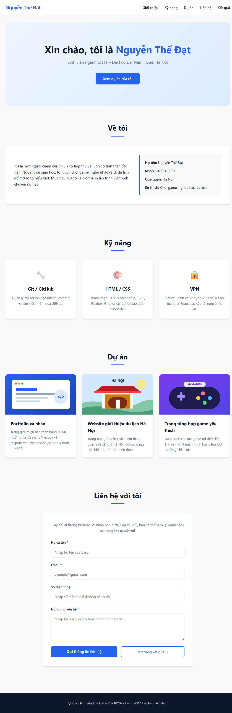
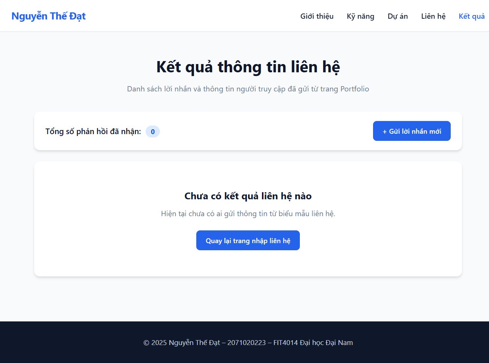

# Danh mục minh chứng

Tài liệu này lập danh mục các trang, ảnh chụp màn hình và tài liệu liên quan đến dự án Portfolio.

| Mã | Nội dung | Minh chứng | Ghi chú |
| --- | --- | --- | --- |
| E01 | Giao diện Portfolio | [Trang chủ](../index.html) · [Ảnh chụp](./envidence/portfolio-home.png) · [Website trực tuyến](https://nthedat39-maker.github.io/K20_PORTFOLIO_CNTT-20-04/) | Ảnh chụp toàn trang từ bản dự án hiện tại |
| E02 | Trang kết quả liên hệ | [Trang kết quả](../ket-qua.html) · [Ảnh chụp](./envidence/contact-results.png) · [Trang trực tuyến](https://nthedat39-maker.github.io/K20_PORTFOLIO_CNTT-20-04/ket-qua.html) | Ảnh chụp trang khi chưa có phản hồi |
| E03 | Kiểm tra website | [Nhật ký kiểm tra](./AI_LOG.md) | Kết quả kiểm tra đường dẫn CSS và mã phản hồi HTTP |
| E04 | Khai báo sử dụng AI | [Nhật ký AI](./AI_LOG.md) | Mục đích sử dụng AI và nội dung người thực hiện rà soát |
| E05 | Lịch sử phát hành | [CHANGELOG](../CHANGELOG.md) · [Release notes](../REALEAS_NOTES.md) | Các thay đổi được ghi cho V7 và V8 |

## Ảnh chụp màn hình

Ảnh được chụp từ các trang trong bản dự án hiện tại và lưu trong thư mục [envidence](./envidence/). Nhấn vào ảnh để mở tệp kích thước đầy đủ.

### E01 — Giao diện Portfolio

### E02 — Trang kết quả liên hệ

